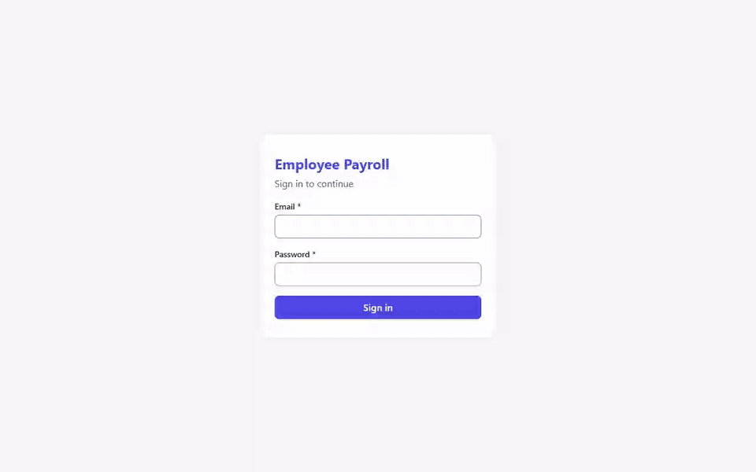

# Employee Management & Payroll

[](https://github.com/MomenKoprossy/interface-code-assessment/actions/workflows/ci.yml)

A small HR application: employee CRUD with validation, search and pagination, plus a configurable monthly payroll
calculator (progressive tax brackets, capped social insurance). It has an ASP.NET Core (.NET 10) API, a React +
TypeScript frontend with plain SCSS (no UI kit or CSS framework), and PostgreSQL.

It's built on my own **DotnetPlayGround** platform template, cut down to what this problem needs: a modular monolith on
the template's building blocks, with service-grade module boundaries enforced by architecture tests.

## Demo



46 s, recorded with `playwright-cli` against the production Docker stack ([MP4](docs/demo.mp4)). The payslip shown is
checked by hand in the captions: 9,000.00 − 825.00 SI − 985.00 tax − 300.00 loan = **6,890.00**.

---

## Run it

Prerequisite: Docker.

```bash
cp .env.example .env          # then set JWT_KEY, POSTGRES_PASSWORD and DEMO_PASSWORD
docker compose up --build
```

Open **http://localhost:8080**. Swagger UI is at http://localhost:8080/swagger.

| Demo login | Role | Can do |
|---|---|---|
| `hr@acme.test` | HR | everything: employees CRUD, any payslip |
| `sara.ahmed@acme.test`, `omar.hassan@acme.test` | Employee | only their own payslip |

Password for all three: the `DEMO_PASSWORD` you put in `.env`. The database is seeded with about 15 employees on first start.
Changed `.env` after the first start? Run `docker compose down -v` to recreate and reseed the database.

### Development

```bash
dotnet run --project backend/src/AppHost       # Aspire: Postgres + API + Vite dev server + dashboard (logs/traces)
```

or run the pieces yourself: `dotnet run --project backend/src/Api` (needs `ConnectionStrings__appdb`, `Jwt__Key` and, for the demo logins, `Seed__DemoPassword`) and
`cd frontend && npm ci && npm run dev`.

### Tests

```bash
dotnet test backend/EmployeePayroll.slnx                     # unit + architecture + API integration (needs Docker)
dotnet test backend/src/BuildingBlocks/BuildingBlocks.slnx   # the vendored platform building blocks
cd frontend && npm test
```

CI ([`.github/workflows/ci.yml`](.github/workflows/ci.yml)) runs all of the above on every push, plus lint, typecheck and
the production build. It then builds the Docker images, brings the compose stack up and checks it through nginx.

**End to end in a real browser:** 8 user cycles (auth, list, create, edit, delete, payslip, employee role, responsive and
accessibility) were driven through the compose stack with `playwright-cli` and repeated until a run came back clean.
Each finding was verified before it was fixed. The demo above was recorded the same way. These runs are not part of the
automated suites.

---

## Architecture

```
frontend (React/TS/SCSS) ──/api──▶ Api host (composition root only)
                                     ├─ Employees module   core │ contracts │ infrastructure
                                     ├─ Payroll module     core │ contracts │ infrastructure ── uses Employees.Contracts only
                                     ├─ Identity module    core │ infrastructure
                                     └─ BuildingBlocks: Core · Data · Web  (+ Messaging · Grpc · Storage · Caching, vendored for growth)
                                   PostgreSQL: one database, one schema per module
```

- **Modular monolith, not microservices** (ADR-001). One bounded context doesn't justify a gateway, a broker and a
  cache. The modules keep service-grade boundaries anyway: other modules can only see a module's `Contracts`, each
  module owns its schema, and NetArchTest rules fail the build if a module core references EF Core or ASP.NET.
- **Clean/hexagonal inside each module** (ADR-003). The `core` project (domain + use cases + ports) references only
  `BuildingBlocks.Core` and other modules' `Contracts`, so business rules can't reach the framework, the database or HTTP. Adapters (EF, endpoints)
  live in `Infrastructure`. The `Api` project only composes.
- **Request flow**: thin endpoint → mediator pipeline (logging → FluentValidation) → handler
  returning `Result` → mapped to HTTP status / RFC 7807 ProblemDetails. One global exception handler, no try/catch in handlers.
- **Payroll** is a pure, ordered pipeline of rules (gross → social insurance → progressive tax → other deductions)
  driven by validated configuration (ADR-006). A new post-tax deduction type is one rule class plus one registration line (a unit test proves it);
  a pre-tax deduction also needs a draft/contract field.
- **Money** is `decimal` / `numeric(18,2)`. Every payslip line is rounded to 2dp half away from zero, and totals are sums of
  rounded lines, so a payslip always adds up to the cent (ADR-007).
- **Auth**: JWT with roles and permission claims, enforced server-side. An Employee can read only their own payslip (ADR-008).

Full design: [`.claude/docs/architecture.md`](.claude/docs/architecture.md) · decisions:
[`.claude/docs/adr/`](.claude/docs/adr/README.md) · API: [`.claude/docs/api-contract.md`](.claude/docs/api-contract.md) ·
payroll spec: [`.claude/docs/payroll-rules.md`](.claude/docs/payroll-rules.md) · growth path:
[`.claude/docs/scalability.md`](.claude/docs/scalability.md)

## Assumptions

- Brackets are **monthly** and apply to taxable income = gross − social insurance (configurable). Upper bounds are inclusive.
- Social insurance = rate × **base** salary, capped by a monthly maximum contribution (optional).
- Allowances are fixed monthly and taxable. "Other deductions" are recurring post-tax amounts stored on the employee.
- No proration: an employee hired on any day of a month gets that month's full pay. Months before the hire month → 422.
- Inactive employees get no payslip (422). Future months are allowed (preview).
- A payslip whose deductions exceed gross pay is refused (422) instead of producing a negative net.
- "Hire date not in the future" is compared against today's date in **UTC**.
- Email uniqueness is case-insensitive and ignores soft-deleted employees.
- Single currency (configured), used for display only.

## Known limitations / next steps

- Payslips are computed on demand, not stored, so **any month (including past ones) uses today's salary data and today's
  policy**. Next: a `PayrollRun` aggregate with immutable payslip snapshots.
- No refresh tokens, and the token lives in sessionStorage. Next: the template's BFF pattern (HttpOnly cookie,
  server-held JWT, refresh tokens).
- Search uses `ILIKE`. Next: a `pg_trgm` index for large tables. Pagination is offset-based.
- No proration or mid-month salary changes.
- No optimistic concurrency: two HR users editing the same employee is last-write-wins. Next: Postgres `xmin` as a
  concurrency token, a version on `EmployeeDetails`/`PUT`, and 409 on conflict.
- Deleting an employee is not announced to other modules (only Active → Inactive raises `EmployeeDeactivated`). Next:
  an `EmployeeRemoved` event in `Employees.Contracts` when a module needs it.
- See [`.claude/docs/scalability.md`](.claude/docs/scalability.md) for how messaging/outbox, gRPC and service
  extraction plug in.

## AI usage

Built with **Claude Code** (Claude Opus 5.5) orchestrating sub-agents. **The code, tests, configuration and docs were
AI-generated**, on top of my own DotnetPlayGround template. I chose to build on the template and set the scope. Claude
proposed the modular-monolith cut and the frontend stack, and I accepted them. Who decided what, plus the agents, tools,
plugins and instructions used, is in [`ai-usage/`](ai-usage/README.md).
